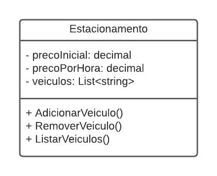

### ‎ >_ `namespace DesafioFundamentos;` | Desafio 02 - Estacionamento

```csharp
Estacionamento es = new Estacionamento(precoInicial, precoPorHora);

es.AdicionarVeiculo();   // 1 - Cadastrar veículo
es.RemoverVeiculo();     // 2 - Remover veículo (e cobrar)
es.ListarVeiculos();     // 3 - Listar veículos
```

> **Legenda:** ☑ `pronto` (entregue e revisado)  •  ☐ `wip` (em andamento)

---

### ✉︎ Sobre o Desafio

`Console.WriteLine("sobre");`

- [x] `const string modulo` Desafio de projeto do módulo **Fundamentos** da trilha .NET, da DIO
- [x] `string linguagem = "C# / .NET 10";` Aplicação de **console** com menu interativo
- [x] `List<string> veiculos` Guarda a placa de cada veículo estacionado
- [x] `// REVISÃO` Bugs corrigidos depois da entrega original (tabela mais abaixo)

---

### ✉︎ Enunciado

`/* resumo do desafio */`

Construir o sistema de um estacionamento, com a classe **`Estacionamento`** conforme o diagrama:



| Membro            | Tipo             | Para quê                                                                             |
|:------------------|:-----------------|:-------------------------------------------------------------------------------------|
| `precoInicial`    | `decimal`        | Preço cobrado para deixar o veículo estacionado                                      |
| `precoPorHora`    | `decimal`        | Preço por hora de permanência                                                        |
| `veiculos`        | `List<string>`   | Placas dos veículos estacionados                                                     |
| `AdicionarVeiculo`| método           | Lê uma placa e guarda em `veiculos`                                                  |
| `RemoverVeiculo`  | método           | Verifica se o veículo está lá, pede as horas, calcula o valor e remove               |
| `ListarVeiculos`  | método           | Lista os veículos ou exibe "Não há veículos estacionados"                            |

Além disso, um **menu interativo** com 4 opções: cadastrar, remover, listar e encerrar.

Cálculo do valor: `valorTotal = precoInicial + precoPorHora * horas`

`// o enunciado da DIO escreve "*" entre os dois preços, mas a conta certa (e a do comentário do código) é a de cima`

`// enunciado original: DIO (resumido aqui)`

---

### ✉︎ Código

`map<arquivo, papel> codigo = { ... };`

| Arquivo                                                                                    | Papel                                                                                       | Status |
|:-------------------------------------------------------------------------------------------|:--------------------------------------------------------------------------------------------|:------:|
| [`DesafioFundamentos/Program.cs`](./DesafioFundamentos/Program.cs)                         | Menu com `switch` e leitura dos preços com `LerValor()`                                     |   ☑    |
| [`DesafioFundamentos/Models/Estacionamento.cs`](./DesafioFundamentos/Models/Estacionamento.cs) | `AdicionarVeiculo()`, `RemoverVeiculo()`, `ListarVeiculos()` e `NormalizarPlaca()`          |   ☑    |
| [`DesafioFundamentos/DesafioFundamentos.csproj`](./DesafioFundamentos/DesafioFundamentos.csproj) | Projeto de console (`net10.0`)                                                              |   ☑    |

---

### ✉︎ Revisão

`git log --oneline --grep="desafio02"`

Cada trecho alterado tem um comentário `// CORREÇÃO` ou `// MELHORIA` no código, explicando o que mudou.

| Tipo       | Onde                                       | O que era                                                                                           | Como ficou                                                                 |
|:-----------|:-------------------------------------------|:----------------------------------------------------------------------------------------------------|:---------------------------------------------------------------------------|
| `fix`      | `Estacionamento.RemoverVeiculo()`          | A busca ignorava maiúsculas, mas o `Remove` não: o programa dizia "removido" e o veículo continuava | A placa é normalizada (`Trim` + maiúsculas) na entrada e na remoção        |
| `fix`      | `Estacionamento.RemoverVeiculo()`          | `int.Parse` derrubava o programa com texto, vazio ou vírgula                                        | `int.TryParse`, rejeitando também horas negativas **antes** de remover     |
| `fix`      | `Program.cs`                               | `Convert.ToDecimal` derrubava o programa com preço inválido                                         | `LerValor()` repete a pergunta até receber um número válido                |
| `feat`     | `Estacionamento.AdicionarVeiculo()`        | Aceitava placa vazia e a mesma placa várias vezes                                                   | Valida placa vazia e duplicada                                             |
| `feat`     | `Estacionamento.RemoverVeiculo()`          | Valor exibido sem casas decimais (`R$ 11`)                                                          | Formato `F2` (`R$ 11,00`)                                                  |

---

### ✉︎ Exemplo de Execução

`./DesafioFundamentos`

```
Seja bem vindo ao sistema de estacionamento!
Digite o preço inicial:
5
Agora digite o preço por hora:
2

Digite a sua opção:
1 - Cadastrar veículo
...
1
Digite a placa do veículo para estacionar:
abc-1234
O veículo ABC-1234 foi cadastrado.

2
Digite a placa do veículo para remover:
abc-1234
Digite a quantidade de horas que o veículo permaneceu estacionado:
3
O veículo ABC-1234 foi removido e o preço total foi de: R$ 11,00
```

`// 5 + 2 * 3 = 11. O separador decimal segue a cultura do computador (vírgula no Brasil)`

---

### ✉︎ Como Executar

`system("dotnet run");`

```bash
cd DesafioFundamentos
dotnet run
```
