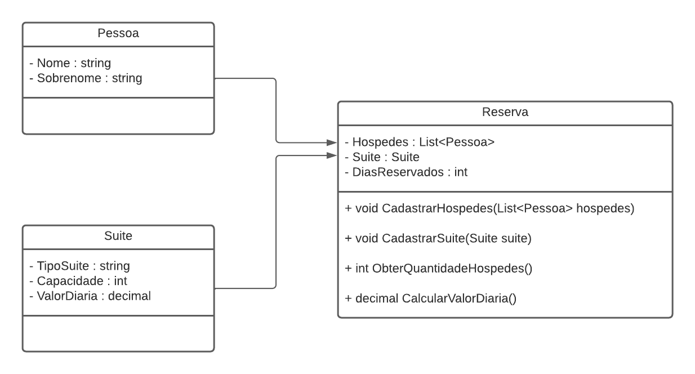

### ‎ >_ `namespace DesafioProjetoHospedagem;` | Desafio 03 - Hospedagem

```csharp
Reserva reserva = new Reserva(diasReservados: 5);
reserva.CadastrarSuite(suite);
reserva.CadastrarHospedes(hospedes);

Console.WriteLine($"Hóspedes: {reserva.ObterQuantidadeHospedes()}");
Console.WriteLine($"Valor diária: {reserva.CalcularValorDiaria()}");
```

> **Legenda:** ☑ `pronto` (entregue e revisado)  •  ☐ `wip` (em andamento)

---

### ✉︎ Sobre o Desafio

`Console.WriteLine("sobre");`

- [x] `const string modulo` Desafio de projeto do módulo **Explorando a linguagem C#**, da trilha .NET (DIO)
- [x] `string linguagem = "C# / .NET 10";` Aplicação de **console** com três classes que se relacionam
- [x] `class Reserva` Faz a ligação entre os hóspedes (`Pessoa`) e a `Suite`, e calcula o valor
- [x] `// REVISÃO` Bugs corrigidos depois da entrega original (tabela mais abaixo)

---

### ✉︎ Enunciado

`/* resumo do desafio */`

Sistema de hospedagem de um hotel, com as classes `Pessoa` (o hóspede), `Suite` e `Reserva`:



**Regras e validações**

| #  | Regra                                                                                                                      | Status |
|:--:|:---------------------------------------------------------------------------------------------------------------------------|:------:|
| 01 | Não é possível reservar uma suíte para mais hóspedes do que a capacidade dela: deve lançar uma exceção                     |   ☑    |
| 02 | `ObterQuantidadeHospedes()` retorna o total de hóspedes e `CalcularValorDiaria()` retorna `dias reservados x valor da diária` |   ☑    |
| 03 | Reservas de **10 dias ou mais** têm **10% de desconto**                                                                    |   ☑    |

`// o texto da DIO fala em "maior que 10 dias" em um ponto e "igual ou maior que 10" em outro; a regra implementada é >= 10`

`// enunciado original: DIO (resumido aqui)`

---

### ✉︎ Código

`map<arquivo, papel> codigo = { ... };`

| Arquivo                                                                         | Papel                                                                                              | Status |
|:--------------------------------------------------------------------------------|:---------------------------------------------------------------------------------------------------|:------:|
| [`Program.cs`](./Program.cs)                                                    | Monta hóspedes, suíte e reserva e exibe a quantidade de hóspedes e o valor da diária               |   ☑    |
| [`Models/Pessoa.cs`](./Models/Pessoa.cs)                                        | Hóspede, com `Nome`, `Sobrenome` e `NomeCompleto`                                                  |   ☑    |
| [`Models/Suite.cs`](./Models/Suite.cs)                                          | Suíte, com `TipoSuite`, `Capacidade` e `ValorDiaria`                                               |   ☑    |
| [`Models/Reserva.cs`](./Models/Reserva.cs)                                      | `CadastrarSuite()`, `CadastrarHospedes()`, `ObterQuantidadeHospedes()` e `CalcularValorDiaria()`   |   ☑    |
| [`DesafioProjetoHospedagem.csproj`](./DesafioProjetoHospedagem.csproj)          | Projeto de console (`net10.0`)                                                                     |   ☑    |

---

### ✉︎ Revisão

`git log --oneline --grep="desafio03"`

Cada trecho alterado tem um comentário `// CORREÇÃO` ou `// MELHORIA` no código, explicando o que mudou.

| Tipo   | Onde                                  | O que era                                                                          | Como ficou                                                                        |
|:-------|:--------------------------------------|:-----------------------------------------------------------------------------------|:----------------------------------------------------------------------------------|
| `fix`  | `Reserva.CadastrarHospedes()`         | Sem suíte cadastrada, estourava `NullReferenceException` (erro difícil de entender) | Lança `InvalidOperationException` pedindo para cadastrar a suíte primeiro         |
| `fix`  | `Reserva.CalcularValorDiaria()`       | Mesmo problema com a suíte nula                                                    | Mesma validação, com mensagem clara                                               |
| `fix`  | `Reserva.Hospedes`                    | A lista começava `null`, e `ObterQuantidadeHospedes()` quebrava antes do cadastro  | Lista inicializada vazia: o método retorna `0`                                    |
| `feat` | `Reserva.CadastrarHospedes()`         | Lançava `Exception` genérica e aceitava lista nula ou vazia                        | `ArgumentException` com os números na mensagem; valida lista nula ou vazia        |
| `fix`  | `Pessoa.NomeCompleto`                 | Sem sobrenome, o texto ficava com espaço sobrando (`"HÓSPEDE 1 "`)                 | `Trim()` remove o espaço                                                          |

---

### ✉︎ Exemplo de Execução

`./Program.cs`

```
Hóspedes: 2
Valor diária: 150
```

`// suíte Premium de 30 por dia, 5 dias: 5 x 30 = 150 (sem desconto, pois são menos de 10 dias)`

---

### ✉︎ Como Executar

`system("dotnet run");`

```bash
dotnet run
```
