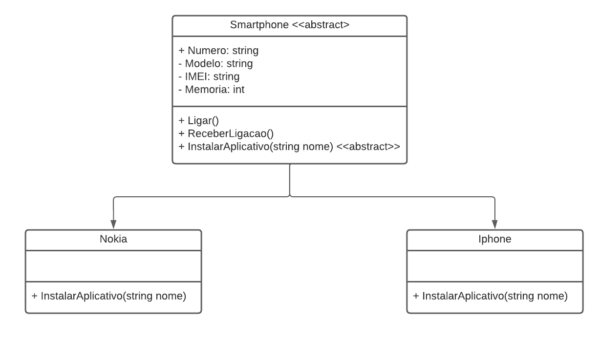

### ‎ >_ `namespace DesafioPOO;` | Desafio 04 - Programação Orientada a Objetos

```csharp
Smartphone[] celulares = { meuNokia, meuIphone };

foreach (var celular in celulares)
{
    celular.Ligar();
    celular.InstalarAplicativo("Spotify");   // cada filha executa a sua versão
}
```

> **Legenda:** ☑ `pronto` (entregue e revisado)  •  ☐ `wip` (em andamento)

---

### ✉︎ Sobre o Desafio

`Console.WriteLine("sobre");`

- [x] `const string modulo` Desafio de projeto do módulo de **Orientação a Objetos** da trilha .NET, da DIO
- [x] `string linguagem = "C# / .NET 10";` Aplicação de **console**
- [x] `abstract class Smartphone` Um modelo de celular que não pode ser instanciado, só herdado
- [x] `// CONCEITOS` classe abstrata • herança • `override` • polimorfismo • construtor com `base(...)`
- [x] `// REVISÃO` Código recuperado do meu commit original e corrigido (tabela mais abaixo)

---

### ✉︎ Enunciado

`/* resumo do desafio */`

Modelar o sistema de celulares de uma loja: uma abstração de celular e uma forma de cada marca ter o seu comportamento, reaproveitando código. As classes seguem o diagrama:



**Regras e validações**

| #  | Regra                                                                                                      | Status |
|:--:|:-----------------------------------------------------------------------------------------------------------|:------:|
| 01 | `Smartphone` é **abstrata**: não pode ser instanciada e serve só de modelo                                 |   ☑    |
| 02 | `Nokia` e `Iphone` são classes **filhas** de `Smartphone`                                                  |   ☑    |
| 03 | `InstalarAplicativo` é **sobrescrito** em `Nokia` e `Iphone`, pois cada um instala de um jeito             |   ☑    |

`// enunciado original: DIO (resumido aqui)`

---

### ✉︎ Código

`map<arquivo, papel> codigo = { ... };`

| Arquivo                                          | Papel                                                                                                   | Status |
|:-------------------------------------------------|:--------------------------------------------------------------------------------------------------------|:------:|
| [`Models/Smartphone.cs`](./Models/Smartphone.cs) | Classe abstrata: `Numero`, `Modelo`, `IMEI`, `Memoria`, `Ligar()`, `ReceberLigacao()` e `InstalarAplicativo()` abstrato |   ☑    |
| [`Models/Nokia.cs`](./Models/Nokia.cs)           | Herda de `Smartphone` e sobrescreve `InstalarAplicativo()`                                              |   ☑    |
| [`Models/Iphone.cs`](./Models/Iphone.cs)         | Herda de `Smartphone` e sobrescreve `InstalarAplicativo()`                                              |   ☑    |
| [`Program.cs`](./Program.cs)                     | Testa o Nokia, o iPhone e o polimorfismo com um array de `Smartphone`                                   |   ☑    |
| [`DesafioPOO.csproj`](./DesafioPOO.csproj)       | Projeto de console (`net10.0`)                                                                          |   ☑    |

---

### ✉︎ Revisão

`git log --oneline --grep="desafio04"`

O fork original do desafio foi excluído do GitHub, mas o meu commit (`f7180a2`, de 07/10/2025) continuava acessível, e foi dele que o código foi recuperado. Cada trecho alterado tem um comentário `// CORREÇÃO` ou `// MELHORIA` no código.

| Tipo   | Onde                          | O que era                                                                                                | Como ficou                                                                     |
|:-------|:------------------------------|:---------------------------------------------------------------------------------------------------------|:-------------------------------------------------------------------------------|
| `fix`  | `Nokia.cs` e `Iphone.cs`      | Sem construtor: `new Nokia(...)` com 4 argumentos não compilava (erros `CS7036` e `CS1729`)              | Construtor que repassa os valores com `: base(...)`                            |
| `fix`  | `Smartphone.cs`               | `imei = imei;` atribuía o parâmetro a ele mesmo (aviso `CS1717`), e a propriedade `IMEI` ficava sempre vazia | `IMEI = imei;`                                                                 |
| `feat` | `Program.cs`                  | Memória `00` e `000` (que são só `0`) apareciam como "0 GB"; acentos podiam quebrar no console do Windows | Valores ilustrativos (`1` e `128`) e `Console.OutputEncoding` em UTF-8         |

`// o diagrama marca Modelo, IMEI e Memoria como privados (-); aqui eles são públicos porque o Program.cs os lê. Fica como ideia no ROADMAP`

---

### ✉︎ Exemplo de Execução

`./Program.cs`

```
Teste Nokia
Número: 1234-5678
Modelo: Nokia 3310
IMEI: 111222333444555
Memória: 1 GB
Ligando...
Recebendo ligação...
WhatsApp instalado no Nokia...

Teste iPhone
Número: 991413637-
Modelo: iPhone 14
IMEI: 555444333222111
Memória: 128 GB
Ligando...
Recebendo ligação...
TikTok instalado no iPhone...

Teste Polimorfismo
Ligando...
Spotify instalado no Nokia...
Ligando...
Spotify instalado no iPhone...
```

---

### ✉︎ Como Executar

`system("dotnet run");`

```bash
dotnet run
```
