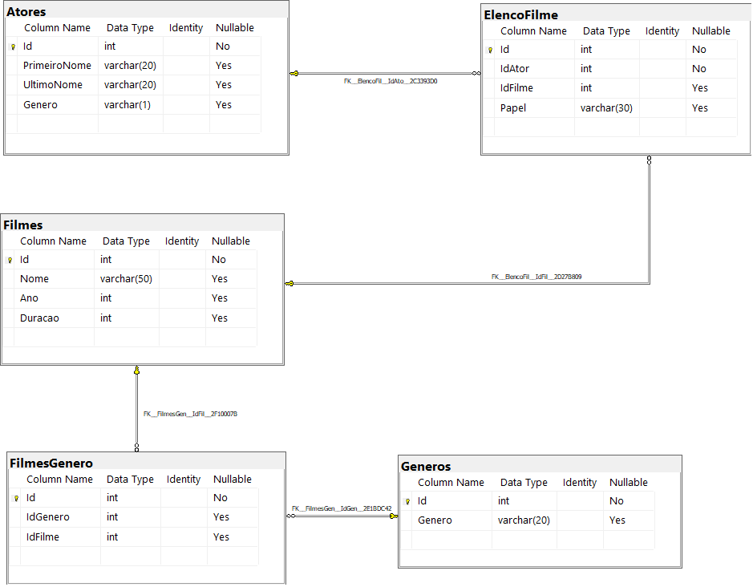

### ‎ >_ `SELECT * FROM Filmes;` | Desafio 05 - Banco de Dados (Filmes)

```sql
SELECT F.Nome, A.PrimeiroNome, A.UltimoNome, E.Papel
FROM ElencoFilme E
JOIN Atores A ON E.IdAtor = A.Id
JOIN Filmes F ON E.IdFilme = F.Id;
```

> **Legenda:** ☑ `pronto` (consulta resolvida)  •  ☐ `wip` (em andamento)

---

### ✉︎ Sobre o Desafio

`SELECT 'sobre';`

- [x] `-- modulo` Desafio de projeto do módulo de **Banco de Dados** da trilha .NET, da DIO
- [x] `-- dialeto` **SQL Server** (T-SQL)
- [x] `-- tarefa` **12 consultas** sobre o banco de um site de filmes e atores
- [x] `-- script` [`Script Filmes.sql`](./Script%20Filmes.sql) cria as tabelas, insere os dados e traz as minhas 12 respostas no final
- [x] `-- online` As consultas podem ser executadas no [SQL Fiddle](https://sqlfiddle.com/sql-server/online-compiler?id=93460682-fdf7-471d-8cae-b543f537a3ea), sem instalar nada

---

### ✉︎ Modelo do Banco

`CREATE TABLE ...`



| Tabela           | Papel                                                                                          |
|:-----------------|:-----------------------------------------------------------------------------------------------|
| `Filmes`         | Informações dos filmes (nome, ano, duração)                                                    |
| `Atores`         | Informações dos atores (nome, gênero)                                                          |
| `Generos`        | Gêneros dos filmes                                                                             |
| `ElencoFilme`    | Relação **muitos para muitos** entre filmes e atores (um ator em vários filmes e vice-versa)   |
| `FilmesGenero`   | Relação **muitos para muitos** entre filmes e gêneros                                          |

---

### ✉︎ Consultas

`vector<Consulta> consultas = { ... };`

Cada linha leva ao trecho da resposta no script e à imagem com o resultado esperado.

| #  | O que buscar                                                                         | Resposta                                                      | Resultado esperado                  | Status |
|:--:|:-------------------------------------------------------------------------------------|:--------------------------------------------------------------|:-----------------------------------:|:------:|
| 01 | Nome e ano dos filmes                                                                | [linhas 212-214](./Script%20Filmes.sql#L212-L214)             | [imagem](./Imagens/1.png)           |   ☑    |
| 02 | Nome e ano dos filmes, ordenados pelo ano (crescente)                                | [linhas 216-219](./Script%20Filmes.sql#L216-L219)             | [imagem](./Imagens/2.png)           |   ☑    |
| 03 | O filme "De Volta para o Futuro", com nome, ano e duração                            | [linhas 221-224](./Script%20Filmes.sql#L221-L224)             | [imagem](./Imagens/3.png)           |   ☑    |
| 04 | Filmes lançados em 1997                                                              | [linhas 226-229](./Script%20Filmes.sql#L226-L229)             | [imagem](./Imagens/4.png)           |   ☑    |
| 05 | Filmes lançados **após** o ano 2000                                                  | [linhas 231-234](./Script%20Filmes.sql#L231-L234)             | [imagem](./Imagens/5.png)           |   ☑    |
| 06 | Filmes com duração entre 100 e 150, ordenados pela duração                           | [linhas 236-240](./Script%20Filmes.sql#L236-L240)             | [imagem](./Imagens/6.png)           |   ☑    |
| 07 | Quantidade de filmes por ano (`GROUP BY`), da maior para a menor quantidade          | [linhas 242-246](./Script%20Filmes.sql#L242-L246)             | [imagem](./Imagens/7.png)           |   ☑    |
| 08 | Atores do gênero masculino (`PrimeiroNome`, `UltimoNome`)                            | [linhas 248-251](./Script%20Filmes.sql#L248-L251)             | [imagem](./Imagens/8.png)           |   ☑    |
| 09 | Atrizes, ordenadas pelo `PrimeiroNome`                                               | [linhas 253-257](./Script%20Filmes.sql#L253-L257)             | [imagem](./Imagens/9.png)           |   ☑    |
| 10 | Nome do filme e gênero (`JOIN` com `FilmesGenero` e `Generos`)                       | [linhas 259-264](./Script%20Filmes.sql#L259-L264)             | [imagem](./Imagens/10.png)          |   ☑    |
| 11 | Nome do filme e gênero do tipo "Mistério"                                            | [linhas 266-272](./Script%20Filmes.sql#L266-L272)             | [imagem](./Imagens/11.png)          |   ☑    |
| 12 | Nome do filme e atores, com `PrimeiroNome`, `UltimoNome` e `Papel` (`JOIN` triplo)   | [linhas 274-281](./Script%20Filmes.sql#L274-L281)             | [imagem](./Imagens/12.png)          |   ☑    |

`-- o script foi adaptado para o SQL Fiddle (sem GO e sem as cláusulas WITH/ON [PRIMARY]); os comentários dentro dele explicam o que foi removido`

---

### ✉︎ Conceitos Usados

`vector<string> conceitos = { ... };`

| Conceito                          | Onde aparece                      |
|:----------------------------------|:----------------------------------|
| `SELECT`, `FROM`                  | consultas 01 a 12                 |
| `WHERE` com `=`, `>`, `AND`       | consultas 03 a 06, 08, 09 e 11    |
| `ORDER BY` (`ASC` e `DESC`)       | consultas 02, 06, 07 e 09         |
| `GROUP BY` com `COUNT(*)`         | consulta 07                       |
| `JOIN` (duas e três tabelas)      | consultas 10, 11 e 12             |

---

### ✉︎ Como Executar

`sqlcmd -i "Script Filmes.sql"`

1. **Sem instalar nada:** abra o [SQL Fiddle](https://sqlfiddle.com/sql-server/online-compiler?id=93460682-fdf7-471d-8cae-b543f537a3ea) e rode as consultas
2. **No seu SQL Server:** execute o [`Script Filmes.sql`](./Script%20Filmes.sql) para criar as tabelas e os dados, e depois rode cada consulta separadamente

`// enunciado original: DIO (resumido aqui)`
