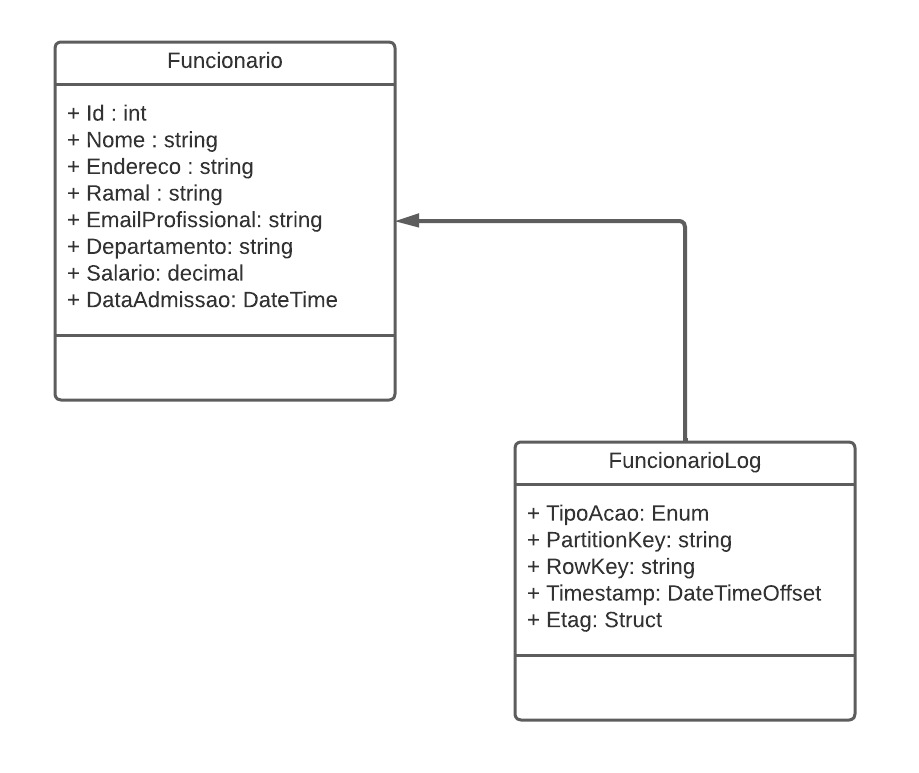
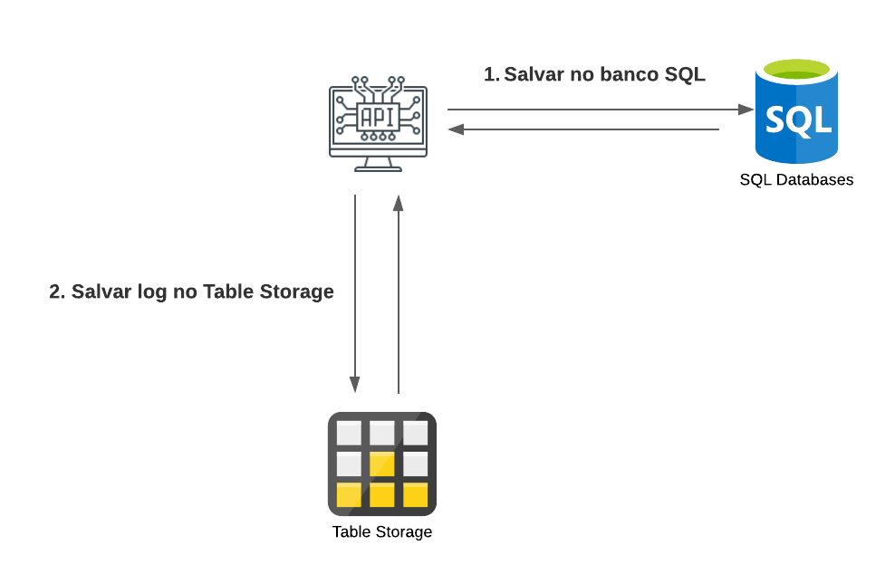
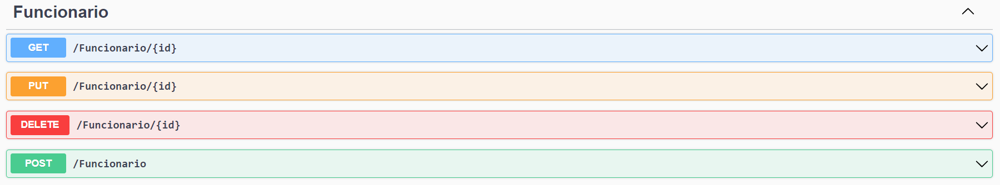

### ‎ >_ `namespace TrilhaNetAzureDesafio;` | Desafio 07 - Sistema de RH no Azure

```csharp
_context.Funcionarios.Add(funcionario);
_context.SaveChanges();                                   // grava no SQL Server

var funcionarioLog = new FuncionarioLog(funcionario, TipoAcao.Inclusao, funcionario.Departamento, Guid.NewGuid().ToString());
tableClient.UpsertEntity(funcionarioLog);                 // registra o log no Azure Table
```

> **Legenda:** ☑ `pronto` (implementado)  •  ☐ `wip` (pendente)

---

### ✉︎ Sobre o Desafio

`Console.WriteLine("sobre");`

- [x] `const string modulo` Desafio de projeto do módulo **Nuvem com Microsoft Azure**, da trilha .NET (DIO)
- [x] `string tipo = "Web API";` **ASP.NET Core** com **Entity Framework Core** e **Swagger**
- [x] `SQL Server` Guarda os funcionários (banco relacional)
- [x] `Azure Table` Guarda o **log de toda alteração** feita em um funcionário
- [x] `// REVISÃO` `TODO`s completados depois da entrega original (tabela mais abaixo)
- [ ] `// TODO` Publicação no Azure (App Service + SQL Database + Azure Table): não está feita neste repositório

---

### ✉︎ Enunciado

`/* resumo do desafio */`

Um sistema de RH com **CRUD de funcionários** que **registra em log** todas as alterações. A classe `FuncionarioLog` é filha de `Funcionario`, porque o log guarda as mesmas informações:



Ambiente previsto no Azure: **App Service** (API), **SQL Database** (relacional) e **Azure Table** (logs):



`// enunciado original: DIO (resumido aqui)`

---

### ✉︎ Endpoints

`map<endpoint, metodo> api = { ... };`



| Verbo    | Endpoint              | Método no código                                                                                  | Log no Azure Table        | Respostas             | Status |
|:---------|:----------------------|:--------------------------------------------------------------------------------------------------|:--------------------------|:----------------------|:------:|
| `GET`    | `/Funcionario/{id}`   | [`ObterPorId`](./Controllers/FuncionarioController.cs)                                            | não gera                  | `200` • `404`         |   ☑    |
| `POST`   | `/Funcionario`        | [`Criar`](./Controllers/FuncionarioController.cs)                                                 | `TipoAcao.Inclusao`       | `201` • `400`         |   ☑    |
| `PUT`    | `/Funcionario/{id}`   | [`Atualizar`](./Controllers/FuncionarioController.cs)                                             | `TipoAcao.Atualizacao`    | `200` • `400` • `404` |   ☑    |
| `DELETE` | `/Funcionario/{id}`   | [`Deletar`](./Controllers/FuncionarioController.cs)                                               | `TipoAcao.Remocao`        | `204` • `404`         |   ☑    |

Exemplo de corpo (`POST` e `PUT`):

```json
{
  "nome": "Nome funcionario",
  "endereco": "Rua 1234",
  "ramal": "1234",
  "emailProfissional": "email@email.com",
  "departamento": "TI",
  "salario": 1000,
  "dataAdmissao": "2022-06-23T02:58:36.345Z"
}
```

---

### ✉︎ Código

`map<arquivo, papel> codigo = { ... };`

| Arquivo                                                                                | Papel                                                                                          | Status |
|:---------------------------------------------------------------------------------------|:-----------------------------------------------------------------------------------------------|:------:|
| [`Controllers/FuncionarioController.cs`](./Controllers/FuncionarioController.cs)       | Os 4 endpoints e o `GetTableClient()` (cria a tabela de logs se ela não existir)              |   ☑    |
| [`Models/Funcionario.cs`](./Models/Funcionario.cs)                                     | Entidade do funcionário                                                                        |   ☑    |
| [`Models/FuncionarioLog.cs`](./Models/FuncionarioLog.cs)                               | Herda de `Funcionario` e implementa `ITableEntity` (`PartitionKey` = departamento, `RowKey` = `Guid`) |   ☑    |
| [`Models/TipoAcao.cs`](./Models/TipoAcao.cs)                                           | `enum` com `Inclusao`, `Atualizacao` e `Remocao`                                               |   ☑    |
| [`Context/RHContext.cs`](./Context/RHContext.cs)                                       | `DbContext` com o `DbSet<Funcionario>`                                                         |   ☑    |
| [`Migrations/`](./Migrations/)                                                         | Migration `Initial`, que cria a tabela `Funcionarios`                                          |   ☑    |
| [`Program.cs`](./Program.cs)                                                           | Configura o `DbContext` (`ConexaoPadrao`), os controllers e o Swagger                          |   ☑    |
| [`trilha-net-azure-desafio.csproj`](./trilha-net-azure-desafio.csproj)                 | Projeto `net10.0` com EF Core, Azure.Data.Tables e Swashbuckle                                 |   ☑    |

---

### ✉︎ Revisão

`git log --oneline --grep="desafio07"`

Cada trecho alterado tem um comentário `// IMPLEMENTADO` ou `// MELHORIA` no código, explicando o que mudou.

| Tipo   | Onde                                   | O que era                                                                      | Como ficou                                                                         |
|:-------|:---------------------------------------|:-------------------------------------------------------------------------------|:-----------------------------------------------------------------------------------|
| `feat` | `Criar()`                              | O funcionário era adicionado, mas nunca salvo; sem log                         | `SaveChanges()` e depois `UpsertEntity()` com o log de inclusão                    |
| `feat` | `Atualizar()`                          | Só `Nome` e `Endereco` eram copiados (mudar salário ou departamento era ignorado); sem `Update` e sem log | Copia todos os campos (menos o `Id`), chama `Update()` e grava o log |
| `feat` | `Deletar()`                            | Só tinha o `SaveChanges()`, sem `Remove()`: nada era apagado de verdade; sem log | `Remove()`, `SaveChanges()` e log de remoção                                       |
| `fix`  | `Criar()` e `Atualizar()`              | Sem departamento (que é a `PartitionKey` do log), o log falharia depois de o funcionário já ter sido gravado no SQL | Validação antes de gravar: responde `400` com mensagem |

---

### ✉︎ Como Executar

`system("dotnet run");`

1. Preencha as três chaves em `appsettings.Development.json` (os campos vêm vazios de propósito: **nunca** versione credenciais):

```json
"ConnectionStrings": {
  "ConexaoPadrao": "<connection string do SQL Server>",
  "SAConnectionString": "<connection string da conta de armazenamento>",
  "AzureTableName": "FuncionarioLog"
}
```

2. Crie o banco com a migration existente e rode:

```bash
dotnet tool install --global dotnet-ef   # uma vez só
dotnet ef database update
dotnet run
```

3. Abra o Swagger em `/swagger` e teste os endpoints.

`// ainda não testado contra SQL Server e Azure reais: os endpoints foram validados com substitutos em memória (veja o ROADMAP)`
