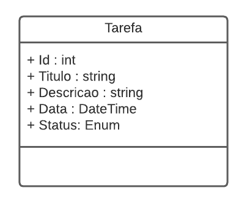
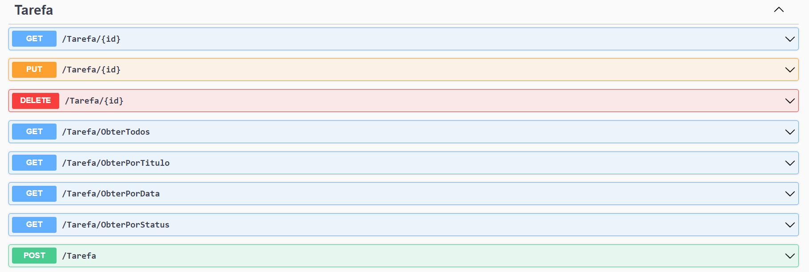

### ‎ >_ `namespace TrilhaApiDesafio;` | Desafio 08 - Gerenciador de Tarefas (API)

```csharp
var tarefas = _context.Tarefas.Where(x => x.Titulo.Contains(titulo)).ToList();
return Ok(tarefas);
```

> **Legenda:** ☑ `pronto` (implementado)  •  ☐ `wip` (pendente)

---

### ✉︎ Sobre o Desafio

`Console.WriteLine("sobre");`

- [x] `const string modulo` Desafio de projeto do módulo **API e Entity Framework**, da trilha .NET (DIO)
- [x] `string tipo = "Web API";` **ASP.NET Core** com **Entity Framework Core** (SQL Server) e **Swagger**
- [x] `class Tarefa` Título, descrição, data e status (`Pendente` ou `Finalizado`)
- [x] `// REVISÃO` `TODO`s completados depois da entrega original (tabela mais abaixo)
- [ ] `// TODO` Gerar e versionar a migration inicial (ainda não existe neste repositório)

---

### ✉︎ Enunciado

`/* resumo do desafio */`

Um gerenciador de tarefas para organizar a rotina, com **CRUD** completo e consultas por título, data e status. A classe principal:



`// enunciado original: DIO (resumido aqui)`

---

### ✉︎ Endpoints

`map<endpoint, metodo> api = { ... };`



| Verbo    | Endpoint                          | Método no código                                                       | O que faz                                                | Respostas             | Status |
|:---------|:----------------------------------|:-----------------------------------------------------------------------|:---------------------------------------------------------|:----------------------|:------:|
| `GET`    | `/Tarefa/{id}`                    | [`ObterPorId`](./Controllers/TarefaController.cs)                      | Busca pela chave primária (`Find`)                       | `200` • `404`         |   ☑    |
| `GET`    | `/Tarefa/ObterTodos`              | [`ObterTodos`](./Controllers/TarefaController.cs)                      | Lista todas as tarefas                                   | `200`                 |   ☑    |
| `GET`    | `/Tarefa/ObterPorTitulo?titulo=`  | [`ObterPorTitulo`](./Controllers/TarefaController.cs)                  | Títulos que **contêm** o texto (`Contains`, vira `LIKE`) | `200` • `400`         |   ☑    |
| `GET`    | `/Tarefa/ObterPorData?data=`      | [`ObterPorData`](./Controllers/TarefaController.cs)                    | Tarefas de um dia                                        | `200`                 |   ☑    |
| `GET`    | `/Tarefa/ObterPorStatus?status=`  | [`ObterPorStatus`](./Controllers/TarefaController.cs)                  | Tarefas com o status informado                           | `200`                 |   ☑    |
| `POST`   | `/Tarefa`                         | [`Criar`](./Controllers/TarefaController.cs)                           | `Add` + `SaveChanges`                                    | `201` • `400`         |   ☑    |
| `PUT`    | `/Tarefa/{id}`                    | [`Atualizar`](./Controllers/TarefaController.cs)                       | Copia os campos para a tarefa do banco e salva           | `200` • `400` • `404` |   ☑    |
| `DELETE` | `/Tarefa/{id}`                    | [`Deletar`](./Controllers/TarefaController.cs)                         | `Remove` + `SaveChanges`                                 | `204` • `404`         |   ☑    |

Exemplo de corpo (`POST` e `PUT`):

```json
{
  "titulo": "Estudar C#",
  "descricao": "Rever orientação a objetos",
  "data": "2026-11-10T10:00:00",
  "status": "Pendente"
}
```

---

### ✉︎ Código

`map<arquivo, papel> codigo = { ... };`

| Arquivo                                                                    | Papel                                                                                   | Status |
|:---------------------------------------------------------------------------|:----------------------------------------------------------------------------------------|:------:|
| [`Controllers/TarefaController.cs`](./Controllers/TarefaController.cs)     | Os 8 endpoints                                                                          |   ☑    |
| [`Models/Tarefa.cs`](./Models/Tarefa.cs)                                   | Entidade da tarefa                                                                      |   ☑    |
| [`Models/EnumStatusTarefa.cs`](./Models/EnumStatusTarefa.cs)               | `enum` com `Pendente` e `Finalizado` (no JSON, vira texto: `JsonStringEnumConverter`)   |   ☑    |
| [`Context/OrganizadorContext.cs`](./Context/OrganizadorContext.cs)         | `DbContext` com o `DbSet<Tarefa>`                                                       |   ☑    |
| [`Program.cs`](./Program.cs)                                               | Configura o `DbContext` (`ConexaoPadrao`), os controllers e o Swagger                   |   ☑    |
| [`TrilhaApiDesafio.csproj`](./TrilhaApiDesafio.csproj)                     | Projeto `net10.0` com EF Core e Swashbuckle                                             |   ☑    |

---

### ✉︎ Revisão

`git log --oneline --grep="desafio08"`

Dos 8 endpoints, 6 estavam incompletos na entrega original (`ObterPorData` e `ObterPorStatus` já funcionavam). Cada trecho alterado tem um comentário `// IMPLEMENTADO` ou `// MELHORIA` no código.

| Tipo   | Onde                                  | O que era                                                       | Como ficou                                                                       |
|:-------|:--------------------------------------|:----------------------------------------------------------------|:---------------------------------------------------------------------------------|
| `feat` | `ObterPorId`                          | Retornava `Ok()` vazio                                          | `Find(id)`: `404` se não existe, `200` com a tarefa se existe                    |
| `feat` | `ObterTodos`                          | Retornava `Ok()` vazio                                          | `ToList()` com todas as tarefas                                                  |
| `feat` | `ObterPorTitulo`                      | Retornava `Ok()` vazio                                          | `Where` + `Contains`, com `400` para título vazio                                |
| `feat` | `Criar`                               | Devolvia `201` sem gravar nada no banco                         | `Add` + `SaveChanges` (o `Id` gerado vai para a URL do `201`)                    |
| `feat` | `Atualizar`                           | Devolvia `Ok()` sem alterar nada                                | Copia os campos (menos o `Id`), `Update` + `SaveChanges`, e devolve a tarefa     |
| `feat` | `Deletar`                             | Devolvia `204` sem apagar                                       | `Remove` + `SaveChanges`                                                         |
| `fix`  | `ObterPorData` e `ObterPorStatus`     | `Where` sem `ToList()`: a consulta só rodava na serialização    | `ToList()` dentro do método, igual aos outros endpoints                          |

---

### ✉︎ Como Executar

`system("dotnet run");`

1. Coloque a sua connection string do SQL Server em `appsettings.Development.json` (hoje está o texto `COLOCAR SUA CONNECTION STRING AQUI`):

```json
"ConnectionStrings": {
  "ConexaoPadrao": "<connection string do SQL Server>"
}
```

2. Este repositório **ainda não tem migration**. Gere a primeira, crie o banco e rode:

```bash
dotnet tool install --global dotnet-ef   # uma vez só
dotnet ef migrations add Inicial
dotnet ef database update
dotnet run
```

3. Abra o Swagger em `/swagger` (aparece só em ambiente de desenvolvimento) e teste os endpoints.

`// ainda não testado contra um SQL Server real: os endpoints foram validados com um substituto em memória (veja o ROADMAP)`
