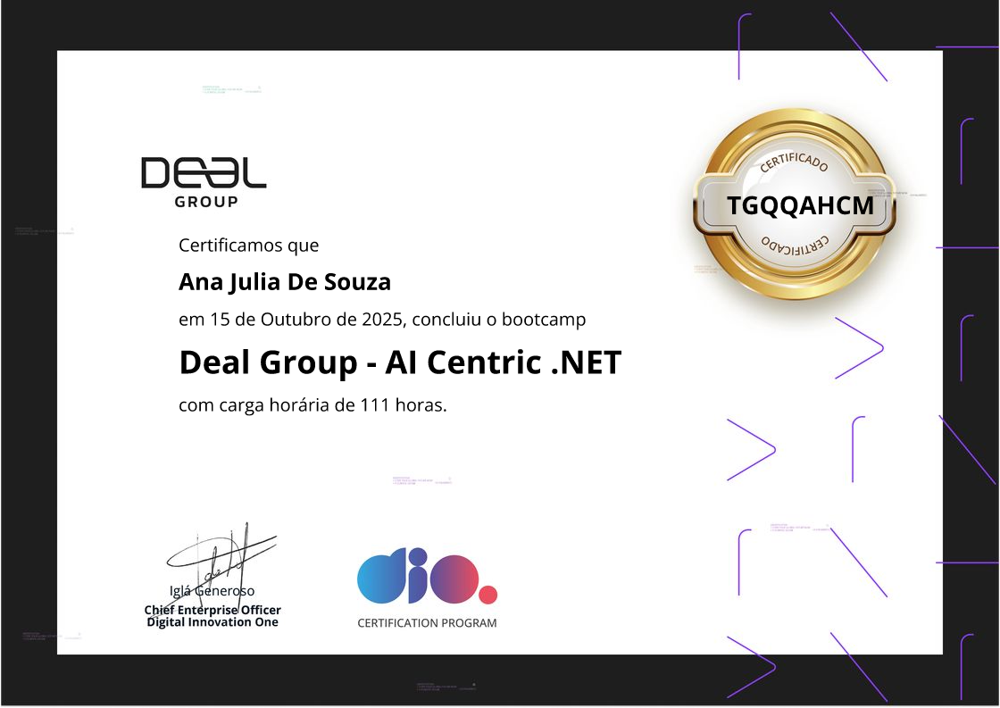

### ‎ >_ `using DIO.AICentricNet;` | Desafios em C# e .NET

[](./certificados/README.md)

### ✉︎ Sobre o Repositório

`Console.WriteLine("sobre");`

- [x] `const string bootcamp` Resoluções dos desafios do bootcamp **Deal Group - AI Centric .NET**, da **DIO**, com **111 horas** (concluído em 15/10/2025)
- [x] `string linguagem = "C# / .NET 10";` Código revisado e atualizado para o **.NET 10**
- [ ] `// TODO` Novos bootcamps e estudos de C#/.NET entrando aqui, cada um na sua pasta ✿

---

### ✉︎ Certificação

`var certificado = new { ... };`

| Campo                   | Valor                                                    |
|:------------------------|:---------------------------------------------------------|
| **Bootcamp**            | Deal Group - AI Centric .NET                             |
| **Carga horária**       | 111 horas                                                |
| **Conclusão**           | 15/10/2025                                               |
| **Conteúdo**            | 41 cursos • 11 desafios de projeto • 3 desafios de código |
| **Código de validação** | `TGQQAHCM`                                               |

O certificado geral e os certificados de cada curso ficam na galeria: [`certificados/`](./certificados/README.md)

---

### ✉︎ Estrutura

`tree .`

```
.
├── README.md
├── .gitignore
├── certificados/
│   ├── README.md
│   ├── geral/                       // certificados
├── Desafio01_projetoOpenSource/
│   ├── README.md
│   └── community/NjjSouza.md        // Profile README no modelo da DIO
├── Desafio02_estacionamento/
│   ├── README.md
│   └── DesafioFundamentos/          // Program.cs + Models/Estacionamento.cs
├── Desafio03_hospedagem/
│   ├── README.md
│   └── Models/                      // Pessoa.cs, Suite.cs, Reserva.cs
├── Desafio04_POO/
│   ├── README.md
│   └── Models/                      // Smartphone.cs, Nokia.cs, Iphone.cs
├── Desafio05_simulacaoBD/
│   ├── README.md
│   └── Script Filmes.sql
├── Desafio06_resumoAzure/
│   └── README.md
├── Desafio07_sistemaRHAzure/
│   ├── README.md
│   └── Controllers/                 // FuncionarioController.cs
└── Desafio08_gerenciadorTarefasAPI/
    ├── README.md
    └── Controllers/                 // TarefaController.cs
```

---

### ✉︎ Desafios

`List<Desafio> desafios = new() { ... };`

| #  | Desafio                                                              | Conceitos                                              | Código de referência                                                                                                  | Status |
|:--:|:---------------------------------------------------------------------|:-------------------------------------------------------|:----------------------------------------------------------------------------------------------------------------------|:------:|
| 01 | [Contribuindo em um Projeto Open Source](./Desafio01_projetoOpenSource/README.md) | Git, GitHub, fork, Profile README                      | [`community/NjjSouza.md`](./Desafio01_projetoOpenSource/community/NjjSouza.md)                                        |   ☑    |
| 02 | [Estacionamento](./Desafio02_estacionamento/README.md)               | `List`, `switch`, laços, validação de entrada          | [`Estacionamento.cs`](./Desafio02_estacionamento/DesafioFundamentos/Models/Estacionamento.cs)                         |   ☑    |
| 03 | [Hospedagem](./Desafio03_hospedagem/README.md)                       | classes, composição, exceções, regra de desconto       | [`Reserva.cs`](./Desafio03_hospedagem/Models/Reserva.cs)                                                              |   ☑    |
| 04 | [POO - Smartphone](./Desafio04_POO/README.md)                        | classe abstrata, herança, `override`, polimorfismo     | [`Smartphone.cs`](./Desafio04_POO/Models/Smartphone.cs)                                                               |   ☑    |
| 05 | [Banco de Dados - Filmes](./Desafio05_simulacaoBD/README.md)         | `SELECT`, `WHERE`, `GROUP BY`, `JOIN`                  | [`Script Filmes.sql`](./Desafio05_simulacaoBD/Script%20Filmes.sql)                                                    |   ☑    |
| 06 | [Resumo de Cloud com Azure](./Desafio06_resumoAzure/README.md)       | nuvem, IaaS/PaaS/SaaS, responsabilidade compartilhada  | [`README.md`](./Desafio06_resumoAzure/README.md)                                                                      |   ☑    |
| 07 | [Sistema de RH no Azure](./Desafio07_sistemaRHAzure/README.md)       | Web API, EF Core, SQL Server, Azure Table              | [`FuncionarioController.cs`](./Desafio07_sistemaRHAzure/Controllers/FuncionarioController.cs)                         |  ☑ *   |
| 08 | [Gerenciador de Tarefas](./Desafio08_gerenciadorTarefasAPI/README.md) | Web API, EF Core, CRUD, Swagger                        | [`TarefaController.cs`](./Desafio08_gerenciadorTarefasAPI/Controllers/TarefaController.cs)                            |  ☑ *   |

`// * 07 e 08 foram validados com substitutos em memória do EF Core e do Azure Table.`

---

### ✉︎ Como Executar

`system("dotnet run");`

Pré-requisito: [.NET SDK 10](https://dotnet.microsoft.com/download)

```bash
# desafios 02, 03 e 04 (console)
cd Desafio02_estacionamento/DesafioFundamentos && dotnet run
cd Desafio03_hospedagem && dotnet run
cd Desafio04_POO && dotnet run
```

Os desafios **07** e **08** são APIs com Entity Framework e SQL Server: o passo a passo (connection string, migrations e Swagger) está no README de cada um.

---

### ✉︎ Créditos

`// enunciados e esqueletos de código: DIO`

Os enunciados, os esqueletos de código e os materiais de apoio pertencem à **[DIO](https://www.dio.me/)** e aos seus instrutores.

---

**Ana Júlia de Souza** • [GitHub @NjjSouza](https://github.com/NjjSouza) 
